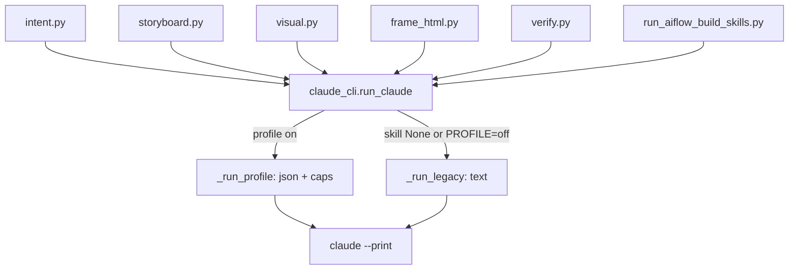
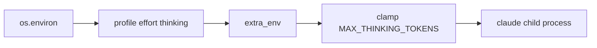

# Claude CLI Skill Profile 设计（提速 / 降本）

> 适用范围：`htmlvideo-worker` 非交互 `claude --print` 调用  
> 主实现：`html_utility/claude_cli.py`  
> 入口：`intent` / `storyboard` / `visual` / `frame_html` / `verify`，以及 `scripts/run_aiflow_build_skills.py`  
> CLI 依据版本：本地核实 2.1.316；容器镜像建议固定并记录实际版本

## 1. 背景与目标

流水线五个 skill 原先共用同一组参数，并继承环境里的 `CLAUDE_CODE_EFFORT_LEVEL=max`，思考走 adaptive、无独立预算。**根因形态**（思考占墙钟大头）仍成立；下列墙钟数字需分清「事故基线」与「skill 侧优化后的最新闭环」——本 profile 调参之前，docs 里**只有 verify 有 11-17 的新闭环**：

| 阶段 | 会话日期 | 墙钟 / 现象 | 数据状态 |
|---|---|---|---|
| storyboard | 11-11（`build-storyboard-5.7m-analysis.md`） | 5.7m；单轮思考 ~223s，输出 94% 为思考 token | 事故基线。11-15/16 已落地契约卡内联 + 单响应双写，报告写明**尚未真跑 A/B**，无更新墙钟 |
| visual | 11-12（`build-frame-visual-13m-analysis.md`） | 13.6m；单块思考 ~10.4m | 事故基线。11-15/16 已落地一次 Write / gate 等；11-16 新跑只记了 gate 误报浪费 ~70s，**无完整阶段新墙钟** |
| frame-html | 11-12（`build-frame-html-63m-analysis.md` + `build-frame-html-deadzone-deepdive.md`） | 63.3m；max+adaptive+32k 无声截断 8–11m/回合 | 事故基线。11-14 已落地 `CLAUDE_CODE_SUBAGENT_EFFORT=high` 等，**docs 无后续全量墙钟闭环** |
| verify | **11-17**（`verify-frame-17m-analysis.md`） | **17.0m**（相对 11-12 的 41.5m 已腰斩）；其中深思考尖峰仍 ~3.2m | **最新闭环**（P3/P4 后）。报告明确：thinking cap 仍是待做项，预期再压到 12–13m |
| identify-intent | （无独立分析文档） | 仅在 verify/storyboard 报告中被引用为同族 63%–86% adaptive thinking | 旁证，非独立实测 |

多数步骤是「按契约填表」或「跑本地脚本 / playbook 修复」，不需要全局 max。目标：

1. **按 skill 分档**设置 effort 与思考预算，可用环境变量覆盖，并可一键回滚。
2. **防跑飞**：轮数上限、墙钟超时（含进程组清理）、禁用流水线无用工具。
3. **可观测**：每次调用打用量日志，支撑 A/B。
4. **不改** prompt、`SKILL.md`、流水线编排。

## 2. 生效机制（CLI 二进制行为）

| 机制 | 正确做法 | 错误 / 无效做法 |
|---|---|---|
| effort | 子进程 env 写 `CLAUDE_CODE_EFFORT_LEVEL` | 只加 `--effort`（会被 env 覆盖） |
| 思考预算 | 子进程 env 写 `MAX_THINKING_TOKENS` | `CLAUDE_CODE_MAX_THINKING_TOKENS`（CLI 不读） |
| thinking 语义 | `>0` → `{type:"enabled", budgetTokens:N}`；`=0` → `{type:"disabled"}` | 改动前为 adaptive，长度不受控 |
| effort + thinking=0 | 可能触发 CLI `effort_requires_thinking` 400 | intent 默认用小正数预算（1024），不用 0 |

注意：

- 项目 `.claude/settings.json` 的 `env` 会在会话启动时 `Object.assign(process.env, …)`，可能覆盖 launcher 注入的值。镜像内 settings **不要**再放 `CLAUDE_CODE_EFFORT_LEVEL` / `MAX_THINKING_TOKENS`。
- 千帆 / deepseek 是否严格按 `budgetTokens` 截断需出站抓包确认；若网关忽略 budget，effort 仍是主杠杆。

## 3. 架构与调用链



`skill=None` 或 `HTMLVIDEO_CLAUDE_PROFILE=off` 时命令与环境与改动前一致（`--output-format text`，不设 timeout，不 PIPE stdout）。

## 4. Profile 表与取值理由

| skill | effort | thinking | max_turns | timeout(s) | deny Agent/Task | 理由 |
|---|---|---|---|---|---|---|
| intent | low | 1024 | 6 | 600 | 是 | 五字段抽取；小预算规避 effort+thinking=0 冲突 |
| storyboard | medium | 8000 | 12 | 1200 | 是 | 契约卡已内联，属填表；上游质量敏感，未直接用 low |
| visual | high | 16000 | 40 | 2400 | 是 | 创作量大，保留 high，截掉单块 96k 跑飞 |
| frame_html | high | 16000 | 120 | 7200 | 否 | 与 worker `effort: high` 一致；16000&lt;32000 治死区；需 Agent |
| verify | medium | 6000 | 150 | 3600 | 是 | 脚本驱动 + playbook；思考 cap 是剩余最大杠杆 |

`frame_html` 另由调用方注入 `CLAUDE_CODE_SUBAGENT_EFFORT=high`（`frame_html.py` 与脚本 `--skill html` 一致）。

基准禁用工具：`WebFetch`、`WebSearch`、`NotebookEdit`、`TodoWrite`；非 html skill 再禁 `Agent`、`Task`（工具名按 CLI 2.1.316；版本漂移时未知名通常为空操作）。

## 5. 命令与 env 组装

Profile 开启时命令形态：

```text
claude --print --dangerously-skip-permissions --permission-mode bypassPermissions
  --output-format json
  --max-turns <N>
  --exclude-dynamic-system-prompt-sections
  --disallowedTools <deny...>
  [--model <M>]
  --
  <prompt>
```

`--` 防止 prompt 被 `--disallowedTools` 变长参数吞掉。



Clamp 规则：

- `0`：关闭思考，保留。
- 非法 / 负数：回退 profile 默认（负数按 0）。
- 值 ≥ 默认输出上限 32000：压到 30000。
- 值 ≥ 当前 `CLAUDE_CODE_MAX_OUTPUT_TOKENS`：压到 `max_output - 1`。
- 当 `CLAUDE_CODE_MAX_OUTPUT_TOKENS` 大于 32000 时，thinking 仍可能被压到 30000（有意保守）。

超时：`Popen(start_new_session=True)` + `communicate(timeout=)`；超时对进程组 `SIGTERM` → 宽限 → `SIGKILL`，返回 **124**。

## 6. 运维接口

| 变量 | 作用 |
|---|---|
| `HTMLVIDEO_CLAUDE_PROFILE=off` | 一键回滚到 legacy 命令与环境 |
| `HTMLVIDEO_CLAUDE_<SKILL>_EFFORT` | 覆盖 effort；白名单 `low\|medium\|high\|xhigh\|max` |
| `HTMLVIDEO_CLAUDE_<SKILL>_THINKING_TOKENS` | 覆盖思考预算 |
| `HTMLVIDEO_CLAUDE_<SKILL>_MAX_TURNS` | 覆盖轮数；≤0 回退默认 |
| `HTMLVIDEO_CLAUDE_<SKILL>_TIMEOUT` | 覆盖超时秒；≤0 回退默认 |
| `HTMLVIDEO_CLAUDE_<SKILL>_MODEL` | 设置则追加 `--model`；默认不设 |

`<SKILL>`：`INTENT` / `STORYBOARD` / `VISUAL` / `FRAME_HTML` / `VERIFY`。

全局 `CLAUDE_CODE_EFFORT_LEVEL=max`（见 `conf/env_htmlvideo_example`）在 **profile 开启时被各 skill 覆盖**；仅 `PROFILE=off` 或未传 `skill` 时作为兜底。

非法 effort / 非正 turns / timeout：打 warning 并回退 profile 默认，不致命失败。

## 7. 返回码与日志

| 情况 | 返回 |
|---|---|
| CLI 正常退出码 | 透传 |
| CLI rc=0 且 JSON `is_error=true` | **1** |
| 墙钟超时 | **124** |
| JSON 解析失败 | 透传 CLI rc，日志打 stdout 尾 2000 字符 |
| `subtype=error_max_turns` | warning；rc 仍按上表 |

日志：

- start：`claude skill start cwd=… skill=… effort=… thinking=… max_turns=… model=… timeout=…`（不打 prompt 正文）
- done：`… subtype=… is_error=… num_turns=… duration_ms=… input=… output=… cache_read=… cache_create=…`
- result：截断 2000 字符（替代原先 text 模式刷到 stdout 的可见摘要）

## 8. 验收与 A/B

**出站抓包**（`/app/log/api-bodies/*.request.json` 或等价捕获器）：

1. `output_config.effort`：intent=low；storyboard/verify=medium；visual/frame_html=high。
2. `thinking`：enabled + `budget_tokens`（intent≈1024）；确认非 adaptive。
3. 工具列表无 WebFetch/WebSearch；非 html 无 Agent。

**耗时预期**（相对 **profile 上线前** 基线；skill 侧优化已计入的用最新闭环，其余先用事故基线作对照，质量门禁不降）：

- verify（最新闭环）：17.0m → ≤13m（吃掉 ~3.2m 思考尖峰）
- storyboard（事故基线 5.7m；契约卡后尚无新墙钟）：对照 ≤2.5m，以用量日志 `num_turns`/`output` 闭环为准
- frame-html：不再出现 `output≈32000` + `end_turn` 且无工具调用的空烧回合
- visual / intent：对照事故旁证或 ≤1m（intent），以新跑用量日志补齐，勿把 13.6m 当「当前常态」

**质量门槛**：各阶段确定性 gate 一次通过率不降；frame-html 重派帧数不增；`verify-report` 终态通过。回退只调对应 skill 的 env，不改代码。

**单测**：`python3 -m unittest html_utility.test_claude_cli -v`。

## 9. 已知限制

1. 千帆是否尊重 `budgetTokens` 以抓包为准；忽略时只靠 effort。
2. `--disallowedTools` 名依赖 CLI 版本；未知名通常无害。
3. thinking clamp 对「输出上限 &gt; 32000」仍可能压到 30000。
4. profile 模式 stdout 被 JSON 解析占用，外部若依赖 text stdout 需改看 worker 日志里的 result 行。
5. `CLAUDE_CODE_DISABLE_NONESSENTIAL_TRAFFIC=1` 为降低遥测/更新检查的附加项，与 profile 正交。
6. `CLAUDE_CODE_DISABLE_GIT_INSTRUCTIONS=1`：去掉内置 git/PR 工作流说明与 git status 快照。`run_claude` 会注入到子进程；本流水线 skills 不依赖 git。视频项目 cwd 勿放大型 `CLAUDE.md` / 多余 MCP（工具 schema 会进 system）。

## 10. 回滚

```bash
HTMLVIDEO_CLAUDE_PROFILE=off
```

行为恢复为：`--output-format text`，不注入 profile env / max-turns / disallowedTools / timeout。
